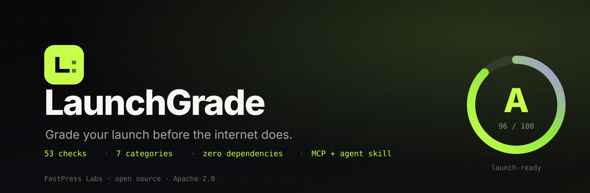

<div align="center">



# LaunchGrade

**Grade your launch before the internet does.**

One command scans any public launch page across **54 checks in 7 categories**, then tells you exactly what to fix first. No account, no tracking, no paid API, no dependencies.

[](https://github.com/fastpresspages/launchgrade/actions/workflows/ci.yml)
[](LICENSE)
[](package.json)
[](package.json)
[](src/checks.js)
[](mcp/server.js)
[](skills/launchgrade/SKILL.md)
[](samples/youlauncher/report.html)

[Free page audit](https://fastpresspages.github.io/launchgrade/#audit) ·
[Sample report](samples/youlauncher/report.html) ·
[Quick start](#quick-start) ·
[Use with an AI agent](#use-with-an-ai-agent) ·
[FastPress Labs](https://github.com/fastpresspages)

</div>

---

## Why LaunchGrade exists

Most launch checklists are either vague (“build trust!”) or enterprise-heavy. LaunchGrade is the 60-second sanity check before you post the link: can a stranger understand the offer, can they act, will the preview card look broken, and will an AI agent recommend you or hallucinate around you?

It is deliberately boring technology: **zero dependencies**, plain Node.js, works offline after install, exits non-zero in CI when the grade is too low, and writes a report you can share.

- **Free forever.** No account, no upsell gate, no telemetry.
- **Fast.** A typical page scans in under a second, extras included.
- **Actionable.** Every failure ships with a concrete fix, not a score with no next step.
- **Agent-ready.** First-class MCP server and skill so Claude, Cursor, Codex and friends can grade a page themselves.
- **Honest.** The score is a transparent weighted checklist. It is not a Lighthouse replacement and it does not pretend to be Google.

## What it checks

| Category | Weight | Examples |
| --- | ---: | --- |
| **Conversion** | 25% | Email capture, specific CTA, social proof, friction, human contact, value proposition, risk reversal |
| **Trust** | 15% | Privacy, terms, about page, real social presence, `security.txt`, current copyright |
| **Technical** | 20% | HTTPS, status, response time, compression, caching, viewport, indexability, canonical, language, favicon, mixed content, analytics |
| **SEO** | 15% | Title and description length, one H1, heading order, image alt text, sitemap, robots, schema, internal links, text ratio |
| **Social sharing** | 10% | Open Graph, Twitter/X card, share image, image alt text |
| **Accessibility** | 5% | Form labels, button names, descriptive links, landmarks, pinch zoom, skip link |
| **AI-agent readiness** | 10% | `llms.txt`, AI crawler access, `AGENTS.md`, Markdown negotiation, MCP/OpenAPI discovery, FAQ, semantic HTML, no-JS copy |

The full list lives in [`src/checks.js`](src/checks.js). Run `launchgrade --list` (or `list_checks` via MCP) to see every check, its weight and why it matters.

## Quick start

Requires **Node.js 18.17+**. Nothing else.

```bash
# One shot, straight from GitHub (no publish required)
npx -p github:fastpresspages/launchgrade launchgrade https://your.site
```

Install it globally if you will use it often:

```bash
npm install -g github:fastpresspages/launchgrade
launchgrade your.site
```

Or work from a clone:

```bash
git clone https://github.com/fastpresspages/launchgrade.git
cd launchgrade
node bin/launchgrade.js https://your.site
```

### Useful flags

```bash
launchgrade your.site --out reports        # report.html, report.json, report.md, badge.svg, fix-plan.md
launchgrade your.site --md                  # Markdown to stdout
launchgrade your.site --json                # machine-readable JSON (validated by our JSON Schema)
launchgrade your.site --fail-under 80       # exit 2 in CI if the score drops
launchgrade your.site --ignore seo.text-ratio,social.og-image-alt
launchgrade your.site --fast                # skip robots.txt, sitemap, llms.txt and other extras
launchgrade your.site --compare old/report.json  # one-scan before/after delta
launchgrade --list                          # every check with weights
```

A normal run takes well under a second on a small page. The timeout is 15 seconds by default.

## Example

This is a real pair of scans of [YouLauncher](https://fastpresspages.github.io/YouLauncher/). The [before report](samples/youlauncher-before/report.html) graded **B- 71/100**. After the rebuild, the [current report](samples/youlauncher/report.html) grades **A+ 100/100**. Same tool, same public URL, both dated 23 Oct 2026. A one-command `--compare` run against the before report [shows the full delta in a single artifact](samples/youlauncher-recovery/report.html): score **▲ +29** and **20 checks improved**, including Open Graph, privacy and llms.txt.

```text
  ▲ LaunchGrade  v0.2.0  ·  fastpresspages.github.io
  https://fastpresspages.github.io/YouLauncher/
  Scanned 10/23/2026, 7:47:47 PM  ·  379 ms  ·  16 KB HTML

  ┌──────────────────────────────────────────────┐
  │  A+  100/100   Launch-ready                  │
  └──────────────────────────────────────────────┘
  48 scored checks  ·  47 pass  1 warn  0 fail  5 info

  Conversion        100  ████████████████████
  Trust             100  ████████████████████
  Technical          98  ███████████████████░
  SEO               100  ████████████████████
  Social sharing    100  ████████████████████
  Accessibility     100  ████████████████████
  AI-agent readiness 100 ████████████████████

  Fix these first
   1. WARN [Tech] Measures visits
```

The one warning is deliberate: the site does not track visitors. LaunchGrade still flags it because most launch pages should measure something before they announce. This is a dated snapshot, not a guarantee about future performance.

The HTML report is self-contained: share it, print it, or commit it. The badge is a plain SVG you can put in your README.

## Reports

`--out <dir>` writes five files:

| File | What it is |
| --- | --- |
| `report.html` | Standalone dark report with grade ring, category grid, every check and a share link |
| `report.md` | Markdown summary plus a `<details>` table of all checks |
| `report.json` | Stable JSON for dashboards and agents — shape published as [schema/report.schema.json](schema/report.schema.json) |
| `badge.svg` | SVG badge with your score |
| `fix-plan.md` | Ordered, impact-weighted fix plan |

### report.json schema

`report.json` is covered by [schema/report.schema.json](schema/report.schema.json) (JSON Schema draft 2020-12). It documents the top-level metadata, `counts`, `categories[]`, `checks[]`, `topFixes[]` and the `comparison` object added by `--compare`. Compatibility policy: additive fields may appear at any release; breaking changes to existing fields require a major version bump. The test suite validates a real report against the schema.

### `--compare <file>`

Point `--compare` at the `report.json` from an earlier scan to get one artifact with the whole before/after story: overall score and grade delta, per-category deltas, every check that moved (fail→pass, pass→warn and regressions in the other direction), and checks that were added or removed because the tool changed. The terminal prints a compact delta table; the HTML and Markdown reports embed the same data; `report.json` carries a `comparison` key.

```bash
launchgrade https://your.site --compare reports/old/report.json --out reports/after
```

For agents and scripts: the delta is also a pure function — `compareResults(baselineReport, currentReport)` in `src/compare.js` — so you can diff reports without launching a browser.

## GitHub Action

```yaml
name: Launch check
on:
  pull_request:
  workflow_dispatch:

jobs:
  grade:
    runs-on: ubuntu-latest
    steps:
      - uses: actions/checkout@v4
      - uses: fastpresspages/launchgrade@main
        with:
          url: https://your.site
          fail-under: 80
          out: launchgrade-report
      - uses: actions/upload-artifact@v4
        if: always()
        with:
          name: launchgrade-report
          path: launchgrade-report
```

The composite action prints the terminal report, writes the report files, and fails the job when the score is below `fail-under`. Set `fail-under: 0` to only report.

## Use with an AI agent

### MCP server

LaunchGrade ships a zero-dependency stdio MCP server with three tools:

- `grade_launch` — scan a URL and return a Markdown or JSON report
- `get_fix_plan` — ranked fixes for a URL
- `list_checks` — the full checklist and weights

Add it to Claude Desktop, Cursor, or any MCP client:

```json
{
  "mcpServers": {
    "launchgrade": {
      "command": "npx",
      "args": ["-y", "-p", "github:fastpresspages/launchgrade", "launchgrade-mcp"]
    }
  }
}
```

Or from a clone:

```json
{
  "mcpServers": {
    "launchgrade": {
      "command": "node",
      "args": ["C:/path/to/launchgrade/mcp/server.js"]
    }
  }
}
```

Then ask: *“Grade https://example.com and fix the three highest-impact issues.”*

### Agent skill

The repo includes a portable skill at [`skills/launchgrade/SKILL.md`](skills/launchgrade/SKILL.md). Install it with the open skills CLI:

```bash
npx skills add fastpresspages/launchgrade
```

Or copy `skills/launchgrade/` into your agent's skills directory. The skill teaches an agent when to run LaunchGrade, how to interpret the score, and how to turn failures into a fix plan without inventing data.

## Scoring

- Every check is `pass` (1), `warn` (0.5), `fail`/`error` (0), or `info` (excluded).
- Each category is normalized to 0–100, then weighted by the table above.
- Grades: **A+** ≥95, **A** ≥90, **A-** ≥85, **B+** ≥80, **B** ≥75, **B-** ≥70, **C+** ≥65, **C** ≥60, **C-** ≥55, **D** ≥40, **F** <40.
- Labels: **Launch-ready** ≥90, **Almost there** ≥80, **Needs polish** ≥70, **Risky launch** ≥60, **Not ready** below 60.
- `--fail-under` compares the numeric score, not the letter.

The score is intentionally opinionated. A page can score well and still be a bad business; LaunchGrade only checks the launch surface it can see.

## Free human audit

Want a second pair of eyes? The [LaunchGrade page](https://fastpresspages.github.io/launchgrade/#audit) has a free audit request form. Tell us the URL, what you are launching, and what is stuck. A human reads it and replies with a prioritized plan. No account, no payment, no drip sequence.

Requests go to the FastPress Labs inbox through FormSubmit. We do not sell or share submissions, and we do not add you to a list you did not ask for.

## Principles

1. **Free means free.** The CLI, action, MCP server, skill and reports are open source under Apache-2.0.
2. **No fake numbers.** The sample above is a real scan with a date and URL. There are no invented users, stars or revenue claims.
3. **No lock-in.** Reports are files. Checks are readable code. Ignore any check you disagree with.
4. **Small surface.** Zero runtime dependencies keeps installs fast and supply-chain risk low.
5. **Useful before impressive.** One tool that people run beats ten landing pages that people bounce from.

## Roadmap

- [x] 54 checks across 7 categories
- [x] HTML, Markdown, JSON, badge and fix-plan output
- [x] GitHub Action and MCP server
- [x] Agent skill
- [x] Real sample audit and public site
- [x] `--compare` before/after delta and a published JSON Schema for `report.json`
- [ ] npm release (`launchgrade` is reserved for this project; publishing needs the maintainer's npm login)
- [ ] Multi-page crawls beyond a single launch page
- [ ] Framework presets (Next.js, Astro, plain HTML)
- [ ] Community-contributed checks with fixtures

Have a check that would have saved your launch? [Open an issue](https://github.com/fastpresspages/launchgrade/issues/new/choose). Small, well-argued checks with a failing fixture are very welcome.

## More from FastPress Labs

- [RepoGrade](https://github.com/fastpresspages/repograde) — grade the **repo** behind the link the same way (33 checks, CLI + Action + MCP; its own dogfood score is A+ 99/100).
- [FastPress Start](https://fastpresspages.github.io/fastpress-start/) — a free, zero-build launch page template. The live demo scores A+ 100/100.
- [YouLauncher](https://fastpresspages.github.io/YouLauncher/) — the rebuilt growth-partner page used in the before/after above.
- [Hire page](https://fastpresspages.github.io/hire-me/) — proof of work, not a padded resume.
- [Agency](https://fastpresspages.github.io/agency/) — the paid side of the lab: launch builds, agents and RAG, when you want it done for you.
- [Placement kit](https://fastpresspages.github.io/placement/) — a free 90-day placement-prep hub with 51 verified free learning links.
- [Outreach field guide](https://github.com/fastpresspages/outreach) — goals, launch plan and honest outreach templates.

## Contributing

Read [`CONTRIBUTING.md`](CONTRIBUTING.md). The short version: fork, add a check plus a fixture, run `node --test`, open a PR. By participating you agree to the [Code of Conduct](CODE_OF_CONDUCT.md).

## Security

LaunchGrade fetches public URLs. It does not execute page JavaScript, does not store submissions, and only reads a small allowlist of well-known files. See [`SECURITY.md`](SECURITY.md) for reporting vulnerabilities.

## License

Apache-2.0 © [FastPress Labs](https://github.com/fastpresspages). See [`LICENSE`](LICENSE) and [`CHANGELOG.md`](CHANGELOG.md).

---

<div align="center">

**Built by [FastPress Labs](https://github.com/fastpresspages) — open-source launch tools for people who ship.**

If LaunchGrade caught something before your launch, [tell us](https://github.com/fastpresspages/launchgrade/issues/new?template=win.yml). Real launch stories are the best changelog.

</div>
